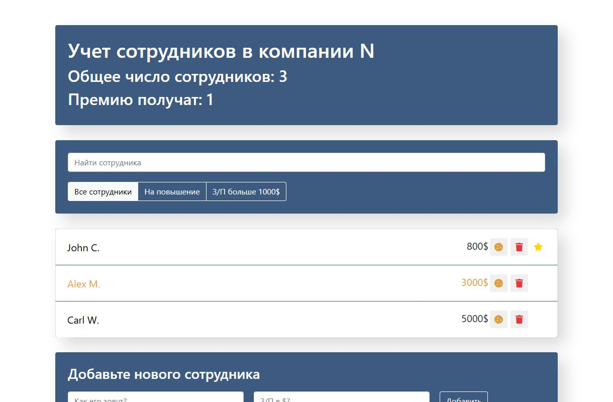

<div align="center">

# 📋 Учёт сотрудников

**Интерактивная таблица для разбора списка сотрудников, зарплат и отметок о премии и повышении.**

  

[Открыть панель](https://goldlexx.github.io/salary/)

</div>

Введите часть имени или выберите фильтр **«На повышение»** либо **«З/П больше 1000$»**. В списке можно отметить сотрудника, добавить новую запись с окладом или удалить существующую. Счётчики над таблицей отражают изменения. Данные хранятся в состоянии React и при перезагрузке восстанавливается исходный список.



## Локальный запуск

```sh
npm ci
npm start
```

Для статической сборки выполните `npm run build`.

## Проверка

`npm test -- --watchAll=false` запускает тесты панели и формы добавления сотрудника.
